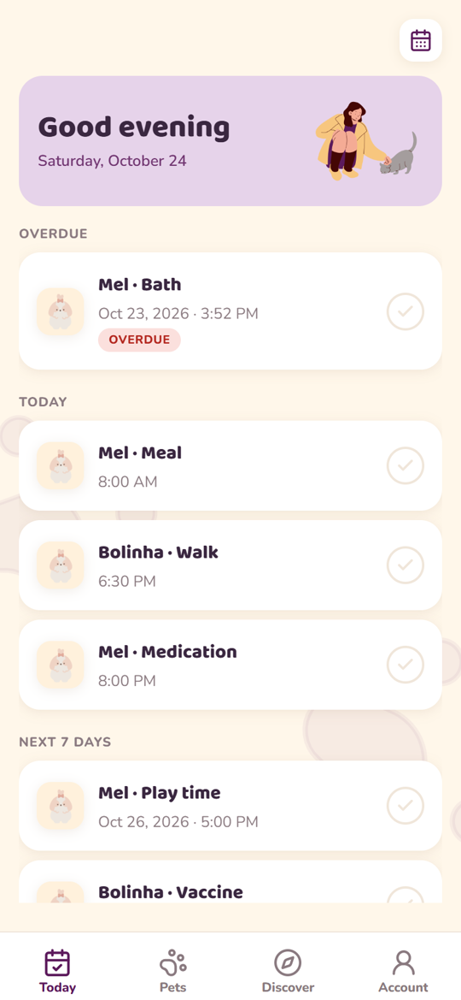
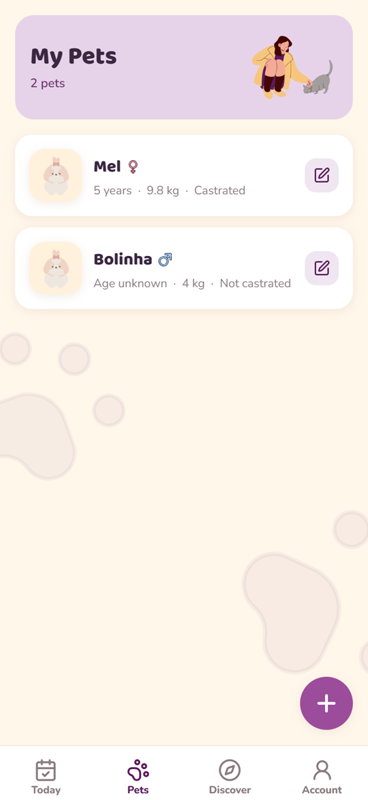
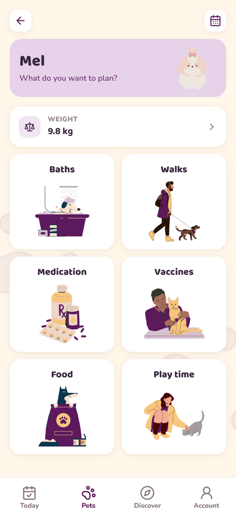
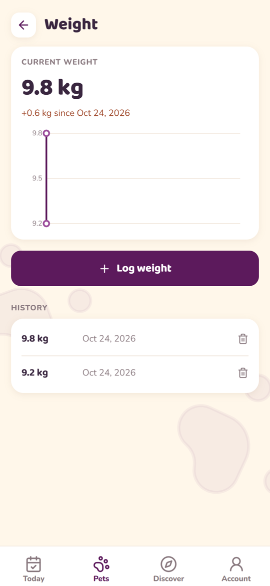
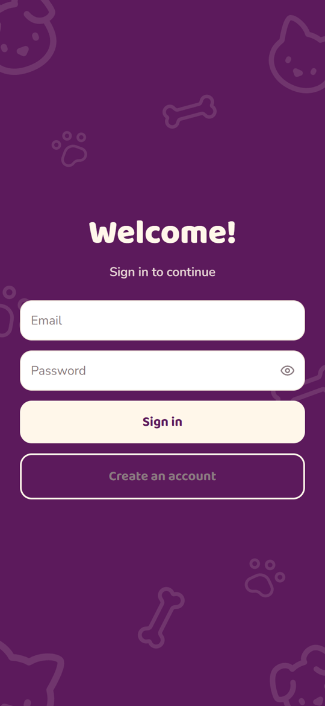
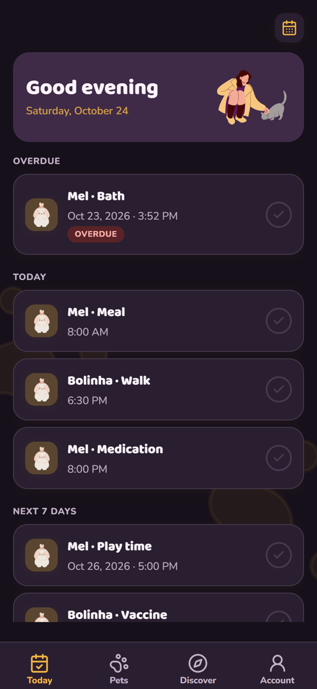
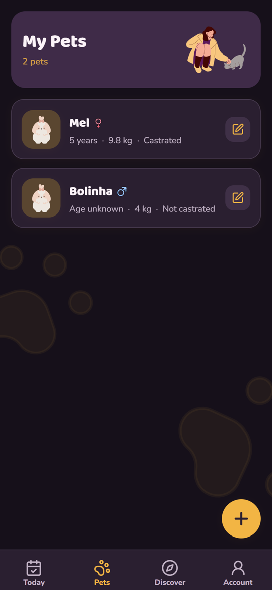
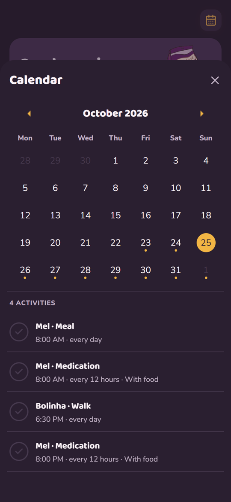
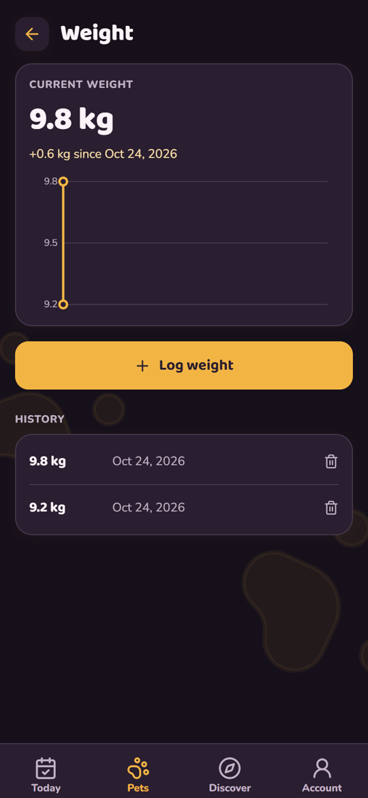
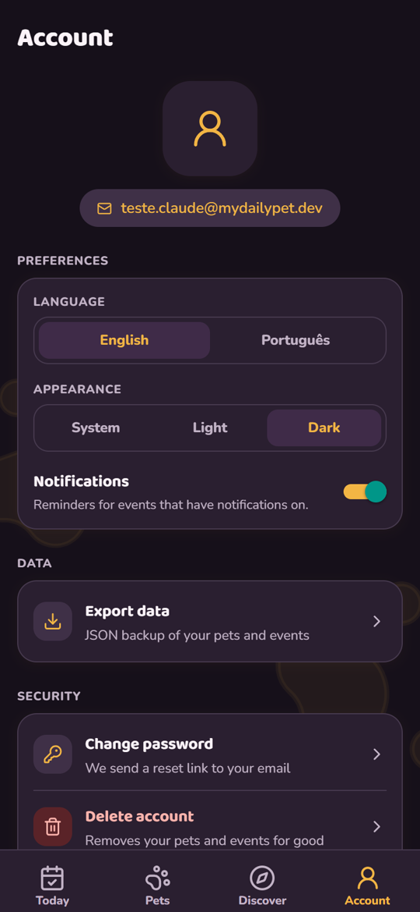

  

<h1 align="center">My Daily Pet</h1>

  Plan and keep track of your pets' daily care: baths, walks, medication, vaccines, 
  meals and play time, with reminders so nothing slips.

  <a href="https://github.com/INARI18/My-Daily-Pet/releases/latest"><b>Download the Android APK</b></a>

## Screenshots

  
  
  
  
  

  
  
  
  
  

## What it does

- **Today**: what is overdue, due today or due in the next 7 days, and a calendar of all pets
- **Pets**: one card per pet with icon, type, gender, birthdate (optional), weight and weight history
- **Events**: recurring or one-time, with notes, "last done" date and a reminder with lead time per event
- **Discover**: veterinary news and recent papers from PubMed
- **Account**: language, light or dark mode, notifications, JSON export, password reset, account deletion

Available in English and Brazilian Portuguese, following the device language.
Light and dark mode follow the system setting, or pick one in Account.

## Install

Download the APK from the [latest release](https://github.com/INARI18/My-Daily-Pet/releases/latest),
open it on your phone and allow installs from unknown sources when asked.
Create an account with email and password and add your first pet.

Built with Expo (React Native) and Firebase.
